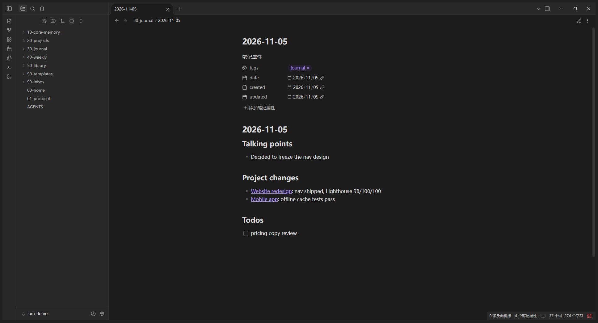

# Obsidian Memory Vault · 给 AI 的长期记忆

> 把 AI 的长期记忆放进**你自己的 Obsidian 库**：偏好、项目、每日记录、周复盘、沉淀库全部落成 Markdown + 双链，任何 Agent 进来读，你自己也能直接看。

**English** — [Jump to the English section](#english).



*截图取自 demo 库（示例数据）：frontmatter 变成可点的属性面板，`[[双链]]` 可跳转，待办可直接勾选。*

---

## 它解决什么

- 换一次会话，AI 就把你的偏好、项目进度、上次的决定全忘了；
- 记忆散在各家工具里（Claude Code、Codex、Cursor…），互相不通；
- 你说「记住这件事」，只换来一句「好的，记住了」——**其实什么都没存**。

## 它给你什么

第一次使用跑一条命令，得到一个能立刻开始记的库：

```
00-home.md            入口（分区地图 + 读取协议）
01-protocol.md        读取 / 每日 / 每周 / 写入规范
AGENTS.md             库内给任意 Agent 的规矩
.memory/config.json   库配置（owner / 布局 / 例程）
10-core-memory/       身份、偏好、红线（靠访谈填实）
20-projects/          项目总览 + 单篇
30-journal/           每日记录
40-weekly/            周复盘
50-library/           沉淀库（方法、经验）
90-templates/         三套模板
99-inbox/             收件箱（先记后整理）
```

之后每次：

| 你说 | 它做 |
|---|---|
| 「整理一下今天」 | 写 `30-journal/`、把变化点同步进项目笔记、归档收件箱 |
| 「做这周复盘」 | 写 `40-weekly/`、净变化回写项目、够格的沉淀进 `50-library/` |
| 「记住……」 | **立刻落盘**，并告诉你写在哪 |
| 「体检一下」 | 查断链 / 缺字段 / 记录缺口 / 索引漏登记 |

## 三步上手

```powershell
# 1. 把技能复制进你的 skills 目录（以 DSH / Zed / Qoder / OpenCode 为例）
#    skills/obsidian-memory  →  ~/.agents/skills/obsidian-memory
# 2. 建库
pwsh -NoProfile -File ~/.agents/skills/obsidian-memory/scripts/init-vault.ps1 -Vault 'D:\vault' -Owner '你的名字'
# 3. 体检
pwsh -NoProfile -File ~/.agents/skills/obsidian-memory/scripts/check-vault.ps1 -Vault 'D:\vault'
```

建完库，让 AI 按 `references/init.md` 做 **8 问访谈**，把 `10-core-memory/` 填实——**不填，库就是个空壳**。

## 两个版本

| 目录 | 语言 | 库结构 |
|---|---|---|
| [`skills/obsidian-memory`](skills/obsidian-memory) | 中文 | `10-核心记忆` / `30-每日记录` / `_索引.md` / `更新:` |
| [`skills/obsidian-memory-en`](skills/obsidian-memory-en) | English | `10-core-memory` / `30-journal` / `_index.md` / `updated:` |

差异不是纯翻译：目录名、索引名、frontmatter 字段都跟着语言走，布局写进库的 `.memory/config.json`，**同一份脚本服务两套库**。

## 五条设计原则

1. **按区读取**：首页 → 索引 → 单篇，绝不全库通读（省 token）；
2. **只写变化点**：结论 + 数字 + 出处，不抄聊天原文；
3. **一天一篇、按日期归位**：漏跑就补，标「（补整理）」；
4. **不改写历史**：口径变了就在新记录里写「更正」；
5. **隐私红线**：他人隐私不提炼不透传，凭证一律不落盘。

## 要求

- PowerShell 7（Windows）；macOS / Linux 可手工建目录 + 复制模板（`references/init.md` 有结构）；
- git（首次提交；不想要加 `-NoGit`）；
- Obsidian（可选，为了看图谱和双链）。

## 不做什么

- 不监听你的对话——要么你说一声，要么自己挂定时任务（`references/wiring.md`）；
- 不替你决定什么值得记——只保证记下来的能被找到、不重复、不过期；
- 无云端、无服务，全部落在你自己的磁盘。

## 目录

```
skills/obsidian-memory/      中文版（SKILL.md + references + scripts + 15 模板）
skills/obsidian-memory-en/   英文版
LICENSE                      MIT
```

## License

MIT。

---

<a id="english"></a>

# English

> Put an AI's long-term memory into **your own Obsidian vault**: preferences, projects, daily notes, weekly reviews and a distilled library, all as Markdown with backlinks — readable by any agent, and by you.

## What you get

One command scaffolds a working vault: home page, protocol, three templates, four indexes, core-memory notes, inbox, and a `.memory/config.json` that records the layout.

## Quick start

```powershell
# 1. copy skills/obsidian-memory-en into your skills root (e.g. ~/.agents/skills/)
# 2. scaffold
pwsh -NoProfile -File obsidian-memory-en/scripts/init-vault.ps1 -Vault 'D:\vault' -Owner 'Your Name'
# 3. check
pwsh -NoProfile -File obsidian-memory-en/scripts/check-vault.ps1 -Vault 'D:\vault'
```

Then run the 8-question interview in `references/init.md`. **Skip it and the vault stays an empty shell.**

## Routines

| You say | It does |
|---|---|
| "tidy up today" | writes `30-journal/`, syncs deltas into project notes, archives the inbox |
| "weekly review" | writes `40-weekly/`, folds net changes into projects, distils into `50-library/` |
| "remember this" | writes to disk immediately and reports the path |
| "check the vault" | broken links, missing fields, daily/weekly gaps, unlisted notes |

## Principles

Read by section, never bulk-read · deltas only · one dated note per day · never rewrite history · privacy red lines.

## License

MIT.